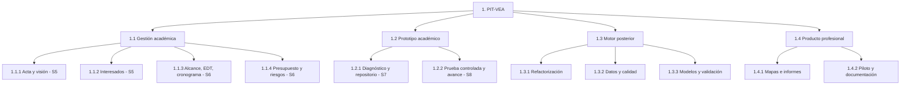

# Alcance del Proyecto y EDT / WBS

## 1. Enunciado del alcance
Desarrollar individualmente, a partir de un prototipo en Python, un motor de análisis territorial reutilizable para estudios de consultoría ambiental en Colombia. La primera entrega académica es de **documentación y demostración controlada**; el desarrollo del MVP continúa después de la semana 8.

## 2. Incluye
- Gestión del proyecto y Wiki ESEIT.
- Inventario y diagnóstico de código existente.
- Parámetros territoriales explícitos; carga de límites y datos.
- Validación de procedencia, geometrías y variables.
- Indicadores ambientales y clustering con evaluación.
- Revisión metodológica de conectividad y valoración económica.
- Exportaciones e informe técnico; pruebas y documentación.

## 3. No incluye
- Plataforma SaaS multiusuario, cobros, licencias comerciales o portal de clientes.
- Trabajo de campo, modelación científica universal ni aprobación oficial de resultados.
- Valorar económicamente cualquier territorio si faltan datos o método.

## 4. EDT / WBS por entregables

## 5. Diccionario de la EDT
| EDT | Paquete | Criterio de aceptación | Periodo |
|---|---|---|---|
| 1.1.1 | Acta y visión | Objetivos, alcance, beneficios y roles explícitos | Semana 5 |
| 1.1.2 | Interesados | Matriz con poder, interés, influencia y estrategia | Semana 5 |
| 1.1.3 | Alcance, EDT, Gantt | Inclusiones/exclusiones, tareas y dependencias | Semana 6 |
| 1.1.4 | Presupuesto y riesgos | Costos estimados, contingencias y responsables | Semana 6 |
| 1.2.1 | Diagnóstico y repositorio | Inventario de módulos, riesgos y archivos versionados | Semana 7 |
| 1.2.2 | Prueba y avance | Evidencia de ejecución parcial o fallo reproducible | Semana 8 |
| 1.3.1 | Refactorización | Punto de entrada sin dependencia del orden de celdas | Posterior |
| 1.3.2 | Datos y calidad | Datos reales identificados; no simulación encubierta | Posterior |
| 1.3.3 | Modelos y validación | Métricas y revisión de supuestos documentadas | Posterior |
| 1.4.1 | Mapas e informes | Productos generados a partir de resultados calculados | Posterior |
| 1.4.2 | Piloto y documentación | Estudio repetible y limitaciones explícitas | Posterior |

## 6. Control de cambios
Toda ampliación de alcance debe indicar horas adicionales y efecto en el hito académico. No adelantar funcionalidades comerciales si comprometen los entregables de semanas 5–8.

[Inicio](Home) · [Acta](Acta-de-Constitucion) · [Interesados](Analisis-de-Interesados) · [Visión](Vision-del-Proyecto) · [Alcance y EDT](Alcance-del-Proyecto) · [Cronograma](Cronograma-del-Proyecto) · [Presupuesto](Presupuesto-del-Proyecto) · [Riesgos](Matriz-de-Riesgos) · [Avance semana 8](Hito-Academico-Semana-8) · [Arquitectura](Arquitectura-Tecnica)
