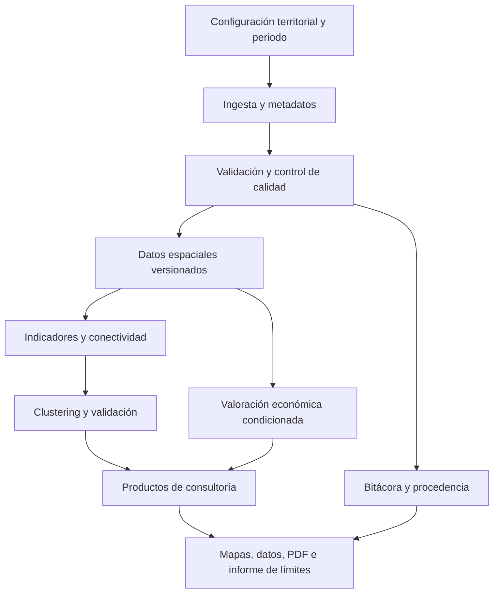

# Arquitectura Técnica — Propuesta de evolución

**Estado:** diseño objetivo; **no** describe componentes desplegados actualmente.

## Estado del prototipo vs. objetivo
| Componente | Prototipo disponible | Desarrollo requerido |
|---|---|---|
| Notebook Python | Sí, versiones previas | Extraer módulos y punto de entrada |
| Ingesta de biodiversidad | Código preliminar | Control de fuente, errores y paginación |
| Datos satelitales | Lógica preliminar con posibles simulaciones | Garantizar extracción real y metadatos |
| K-means | Código preliminar | Resolver función de K y validación espacial |
| Conectividad | Cálculos preliminares | Contrastar significado ecológico |
| Valoración | Fórmulas preliminares | Áreas elegibles, métodos, incertidumbre |
| Mapas y PDF | Generadores preliminares | Sincronizar con resultados y avisos de calidad |
| Aplicación multiusuario | No requerida | Fuera del alcance inicial |

## Stack sugerido, no obligatorio en semana 8
Python, GeoPandas, Rasterio/rioxarray, scikit-learn, ReportLab, Folium o MapLibre. PostgreSQL/PostGIS, Prefect y FastAPI se evaluarían **solo si aportan valor real** al MVP individual; no deben bloquear el hito académico.

## Reglas de calidad
- Ninguna fuente sintética se presenta como real.
- Cada resultado tiene parámetros, fecha, fuente y versión.
- Ninguna superficie de ecosistema se infiere automáticamente de puntos de ocurrencia.
- Los IDs de K-means no determinan categorías ni tarifas económicas.
- El informe refleja los datos efectivamente calculados.

[Inicio](Home) · [Acta](Acta-de-Constitucion) · [Interesados](Analisis-de-Interesados) · [Visión](Vision-del-Proyecto) · [Alcance y EDT](Alcance-del-Proyecto) · [Cronograma](Cronograma-del-Proyecto) · [Presupuesto](Presupuesto-del-Proyecto) · [Riesgos](Matriz-de-Riesgos) · [Avance semana 8](Hito-Academico-Semana-8) · [Arquitectura](Arquitectura-Tecnica)
