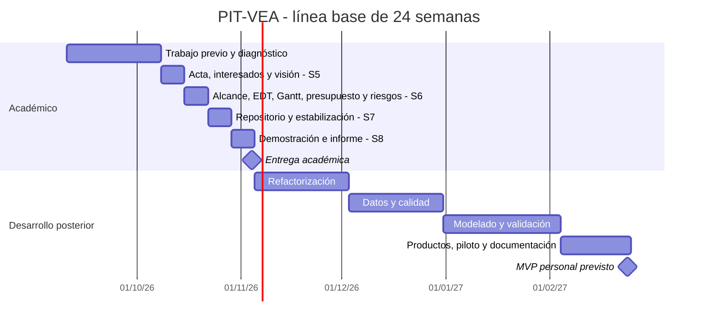

# Cronograma del Proyecto

## 1. Línea base
- **Inicio:** jueves 10 de septiembre de 2026.
- **Semana 8 / hito académico:** miércoles 4 de noviembre de 2026.
- **Finalización tentativa de 24 semanas:** miércoles 24 de febrero de 2027.
- **Capacidad:** 7–8 h/semana; base de presupuesto **7,5 h/semana × 24 = 180 h**.
- **Semanas 5 y 6:** entregas académicas según guía ESEIT; fechas de esta tabla sujetas a confirmación con calendario docente.

## 2. Actividades, fechas y dependencias
| ID | Actividad | Inicio | Fin | Horas | Predecesora | Evidencia |
|---|---|---|---|---:|---|---|
| 1 | Trabajo previo y diagnóstico | 2026-09-10 | 2026-10-07 | 30 | — | Prototipo disponible; inventario por verificar |
| 2 | Iniciación / ESEIT semana 5 | 2026-10-08 | 2026-10-14 | 7.5 | 1 | Acta, interesados, visión |
| 3 | Planeación / ESEIT semana 6 | 2026-10-15 | 2026-10-21 | 7.5 | 2 | Alcance, EDT, Gantt, presupuesto, riesgos |
| 4 | Repositorio y estabilización inicial / semana 7 | 2026-10-22 | 2026-10-28 | 7.5 | 3 | Inventario, dependencias y configuración |
| 5 | Demostración y cierre académico / semana 8 | 2026-10-29 | 2026-11-04 | 7.5 | 4 | Prueba controlada e informe de avance |
| 6 | Refactorización del motor | 2026-11-05 | 2026-12-02 | 30 | 5 | Pipeline autónomo y modular |
| 7 | Ingesta y validación | 2026-12-03 | 2026-12-30 | 30 | 6 | Fuentes, procedencia y QA |
| 8 | Modelado y validación metodológica | 2026-12-31 | 2027-02-03 | 37.5 | 7 | Indicadores y modelos evaluados |
| 9 | Productos, piloto y documentación | 2027-02-04 | 2027-02-24 | 22.5 | 8 | Mapas, informe y pruebas del MVP |

**Nota:** las primeras cuatro semanas representan trabajo previo y diagnóstico; no se afirma que las 30 horas estén ya registradas. Las 180 h son una **línea base estimada**, no horas verificadas.

## 3. Gantt de todo el proyecto

## 4. Ruta crítica preliminar
Documentación → repositorio/diagnóstico → prueba controlada → refactorización → datos/QA → modelado → piloto. Todas las fases se han dispuesto secuencialmente por la disponibilidad de una sola persona. Recalcular al actualizar duraciones.

## 5. Control de avance
Marcar como **completado** solo con enlace a archivo, commit, registro de prueba o documento evaluado. Utilizar la hoja `Plan y costos` del archivo `Presupuesto-y-Plan.xlsx` para registrar avance real.

[Inicio](Home) · [Acta](Acta-de-Constitucion) · [Interesados](Analisis-de-Interesados) · [Visión](Vision-del-Proyecto) · [Alcance y EDT](Alcance-del-Proyecto) · [Cronograma](Cronograma-del-Proyecto) · [Presupuesto](Presupuesto-del-Proyecto) · [Riesgos](Matriz-de-Riesgos) · [Avance semana 8](Hito-Academico-Semana-8) · [Arquitectura](Arquitectura-Tecnica)
